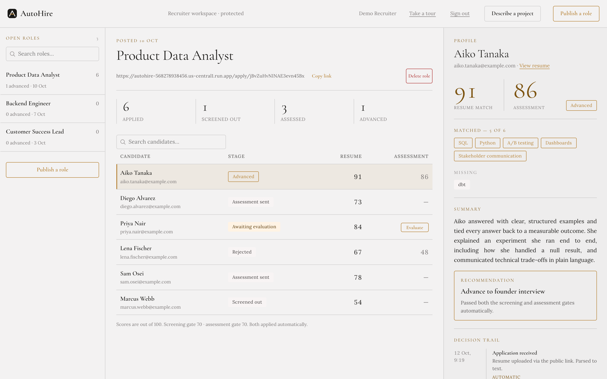
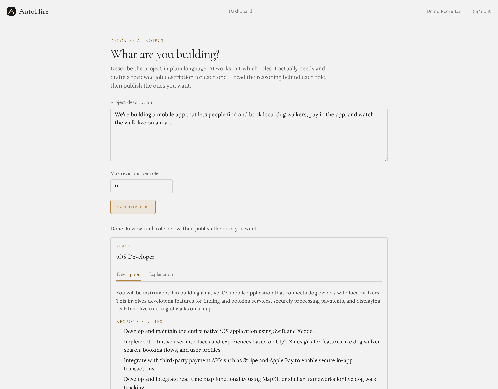
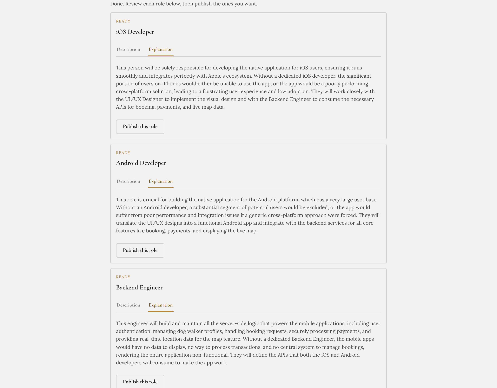
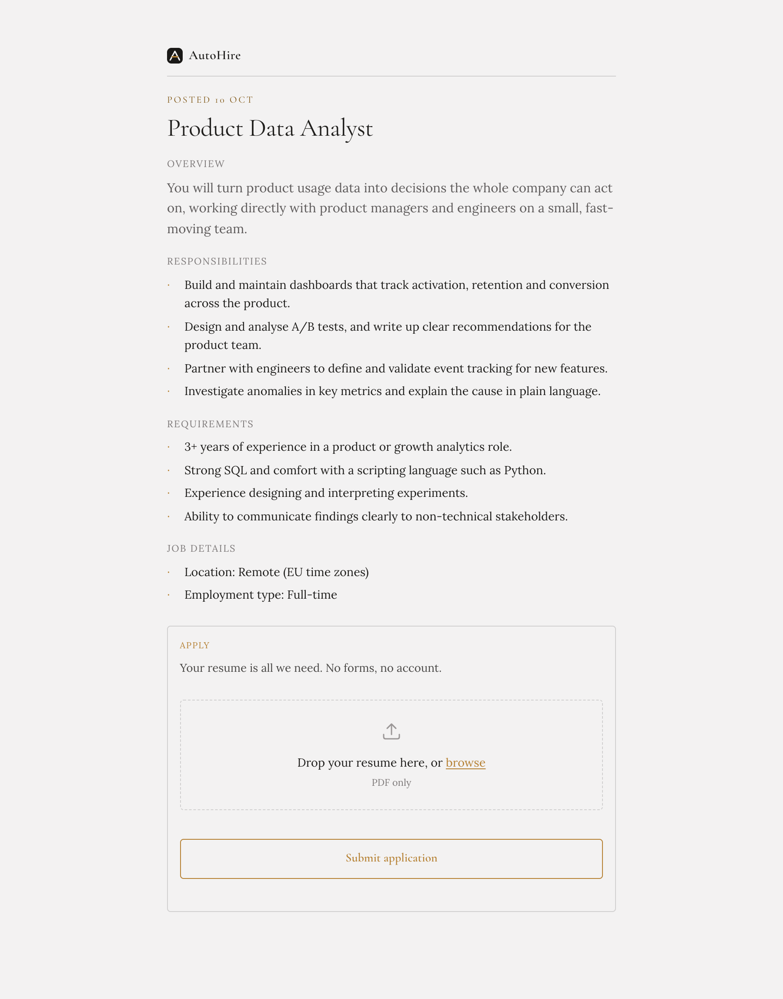
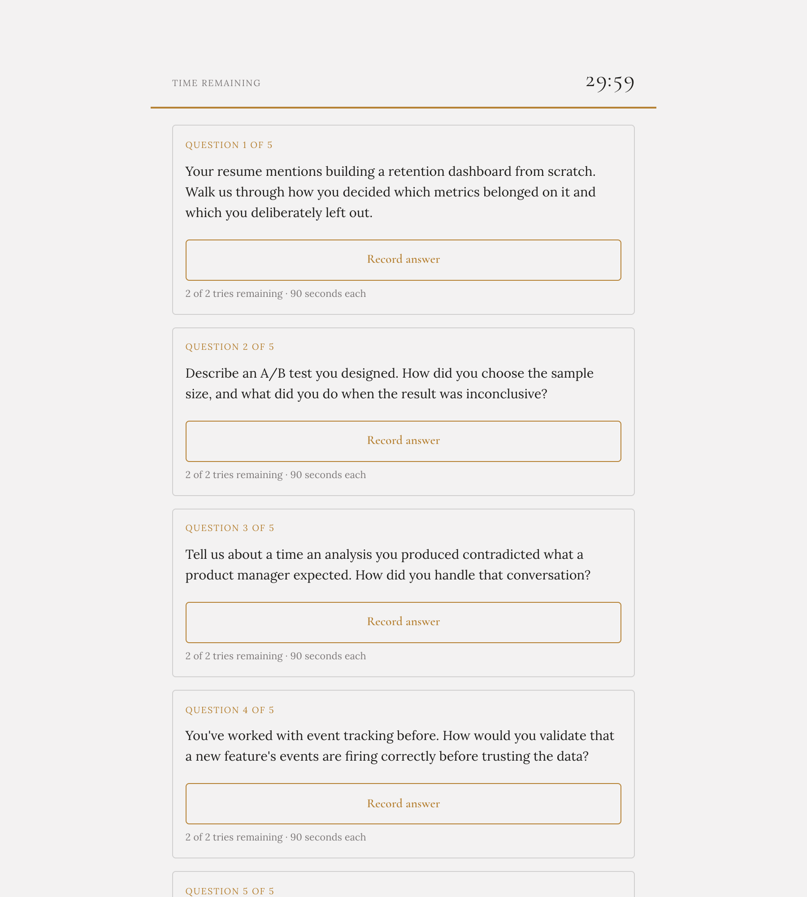
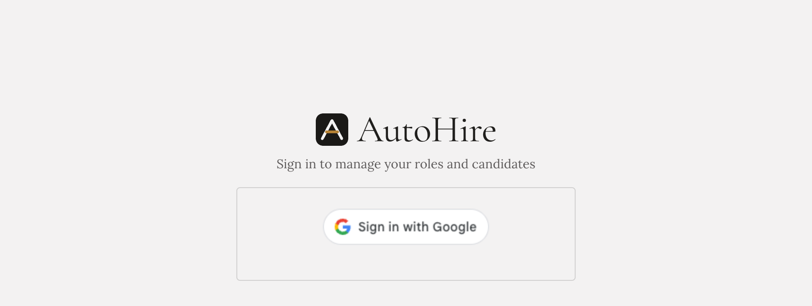

# AutoHire

An AI-driven resume screening and interview pipeline. A recruiter publishes a job and gets a shareable link. A candidate applies with just a resume — no other input. AutoHire parses it, scores it against the job description, and — if it passes — automatically emails the candidate a personalized "you've been shortlisted" message with a link to a timed assessment. The candidate answers each question with its own in-browser recording (2 tries, 90 seconds each, 30 minutes overall); AutoHire evaluates each answer directly against its question and advances or rejects the candidate.

Everything past "publish a job" runs with no human in the loop until the recruiter reviews the final evaluation.

**Live:** https://autohire-568278938456.us-central1.run.app — deployed on Google Cloud Run. Recruiters sign in with Google and each get a private workspace; candidate-facing pages are open to anyone with a job's application link.

## How it works

Single-purpose pages:

| Page | Who uses it | What it does |
|---|---|---|
| `/` | Recruiter (Google sign-in) | Publish a job, get a shareable application link, search and sort candidates per job (with resume, scores, and name), delete a job and all its data, trigger interview evaluation, resend a shortlist email that failed to send |
| `/jobs/team-plan` | Recruiter (Google sign-in) | "Describe a project": describe what you're building and AI plans the team, drafts a reviewed job description for each role, and explains why each role is needed |
| `/apply/<job_id>` | Candidate | See the job description (auto-formatted into sections), upload a resume — nothing else |
| `/interview/<candidate_id>` | Candidate | A timed assessment: see instructions, start a 30-minute clock, record an answer to each question directly in the browser (2 tries, 90s each) — auto-submits whatever's recorded when time runs out |

### Pipeline

1. **Publish a job** — recruiter enters a title + description (or generates one via *Describe a project*); Gemini reformats it into structured sections (Overview, Responsibilities, Requirements, etc.) for the candidate-facing page
2. **Candidate applies** — resume uploaded to Cloud Storage
3. **Parse resume** — Document AI extracts the raw text
4. **Score against the job** — Gemini scores the resume 0-100 against the job description, also extracting the candidate's name and matched/missing skills
5. **Gate** — below threshold → rejected (candidate sees a generic "thanks for applying" either way, never the score)
6. **Generate interview prep** — Gemini extracts the candidate's email and writes 5 questions tailored to their specific experience and the job
7. **Send shortlist email** — Gmail API sends a short, personalized email ("Hello \<Name\>, thanks for applying...") with a link to the candidate's assessment page and a 48-hour deadline (enforced server-side; set by `ASSESSMENT_WINDOW_HOURS`). The email can optionally be held back after applying (`SHORTLIST_EMAIL_DELAY_HOURS`, off by default); a Cloud Scheduler job sends the due ones. If the email can't be sent, the applicant still sees a normal confirmation and the candidate is flagged "Email not sent" on the dashboard, where the recruiter can resend it
8. **Candidate completes the timed assessment** — records an answer to each question in-browser; partial completion is fine, whatever's recorded gets submitted
9. **Evaluate** — Gemini scores each recorded answer directly against its specific question (no speaker-diarization guessing — every clip is unambiguously "the candidate's answer to question N"), factoring in any unanswered questions
10. **Gate** — below threshold → rejected, above → advanced. Recruiter dashboard reflects the final status, both scores, and the candidate's name

### Describe a project

Instead of writing one job description, the recruiter describes a whole project in plain language. A small multi-agent pipeline (plain Python on top of Gemini, no agent framework) plans the team, works out what each role needs *for this project*, writes the job description, and reviews it for vague language and unrealistic requirements — revising until it passes. Progress streams to the page over Server-Sent Events, and each role has a **Description** tab and an **Explanation** tab giving the reasoning for why the role exists. Roles can be published individually from the same page.

### Tech stack

- **Flask** — single backend app, server-rendered HTML + vanilla JS (no frontend framework), deployed on **Cloud Run** via Docker + gunicorn
- **Cloud Storage** — resumes and per-question interview recordings
- **Firestore** — job postings and candidate records/status (the source of truth the whole pipeline reads and writes)
- **Document AI** — resume text extraction (OCR)
- **Vertex AI (Gemini, via `google-genai`)** — resume scoring + name extraction, interview question generation, JD formatting, per-question answer evaluation
- **Gmail API (OAuth)** — sending shortlist emails, credentials stored in **Secret Manager** in production
- **Google Identity Services** — recruiter sign-in, verified server-side
- **MediaRecorder API** — real-time in-browser audio recording on the candidate assessment page

### Security

- Recruiters sign in with Google (ID token verified server-side, signed-cookie session). Every job and candidate is owned by the recruiter who created it, and recruiter-only endpoints check ownership, so each recruiter only sees their own workspace
- Candidate-facing pages (`/apply`, `/interview`) are intentionally open — no login, since candidates shouldn't need an account
- Secrets (`.env`, `client_secret.json`, the Gmail OAuth `token.json`) are gitignored and never enter the repo; in production the Gmail token is injected via a Secret Manager volume mount, not baked into the container

## Project structure

```
app/
  main.py          Flask routes
  clients.py       GCP client setup (Storage, Firestore, Document AI)
  config.py        env-var based configuration
  document_ai.py   resume text extraction
  gemini.py        Gemini prompts (scoring, JD formatting, question generation, answer evaluation)
  role_planner.py  the "Describe a project" multi-agent pipeline
  gmail.py         OAuth + email sending
  templates/       index.html (dashboard), team_plan.html, apply.html, interview.html, login.html
  static/          style.css, app.js
tests/             pytest suite (all cloud clients mocked)
Dockerfile         Cloud Run container definition
```

## Setup

1. Create a GCP project, enable billing, and enable these APIs: Vertex AI, Document AI, Cloud Storage, Firestore, Gmail, Secret Manager.
2. Create a Cloud Storage bucket and a Firestore database (Native mode), same region for both.
3. Create a Document AI **Document OCR** processor (region `us` or `eu`) — note its processor ID.
4. Authenticate locally so the Google client libraries can call these APIs as you:
   ```bash
   gcloud auth application-default login
   ```
5. Set up Gmail OAuth: **APIs & Services → OAuth consent screen**, add yourself as a test user, then **Credentials → Create OAuth client ID → Desktop app**, download the JSON and save it as `client_secret.json` in the project root (gitignored — never commit this).
6. Copy `.env.example` to `.env` and fill in your project ID, region, bucket name, Document AI processor ID, and a random `SECRET_KEY` (for session signing) and a `GOOGLE_OAUTH_CLIENT_ID` (a *Web application* OAuth client; add your local origin, e.g. `http://127.0.0.1:5000`, as an authorized JavaScript origin).
7. Install dependencies:
   ```bash
   python -m venv venv
   source venv/bin/activate
   pip install -r requirements.txt
   ```
8. Run the app:
   ```bash
   python -m app.main
   ```
9. Open `http://127.0.0.1:5000/`, sign in with Google, publish a job, and try the flow. The first time an email is sent, a browser window opens asking you to approve Gmail access — after that it's silent (cached in `token.json`, also gitignored).

### Deploying to Cloud Run

```bash
gcloud run deploy autohire --source . --region us-central1 \
  --set-env-vars GCP_PROJECT_ID=...,GCS_BUCKET_NAME=...,SECRET_KEY=...,GOOGLE_OAUTH_CLIENT_ID=...,BASE_URL=https://your-service-url \
  --set-secrets=/secrets/token.json=gmail-token:latest
```
Store your local `token.json` in Secret Manager (`gcloud secrets create gmail-token --data-file=token.json`) so the deployed container never bundles it directly.

## Status

The full pipeline is built, deployed, and working end to end — publish, apply, screen, personalized email, real-time recorded assessment, evaluation, and a recruiter dashboard to manage it all.

Known limitation: while the Gmail OAuth app is in Google's "Testing" publishing status, its refresh token expires every 7 days and needs re-authenticating. Moving the consent screen to "In production" removes that limit. Until then, an expired token no longer breaks applications — shortlist emails just wait on the dashboard to be resent.

## Demo

Screenshots of the live app. All candidate names, emails and scores shown are synthetic.

### Recruiter dashboard
Roles on the left, candidates in the middle (searchable and sortable), and the selected candidate's profile on the right — scores, matched and missing skills, a summary, a recommendation, and the full decision trail.



### Describe a project
Describe a whole project in plain language. AI works out which roles it actually needs, drafts a reviewed job description for each one, and explains in plain terms why each role is needed.





### Candidate application
Candidates see the role and apply with just a resume — no account, no form.



### Recorded assessment
Shortlisted candidates get a timed, in-browser recorded assessment with tailored questions.



### Sign in
Recruiters sign in with Google and each get a private workspace.


